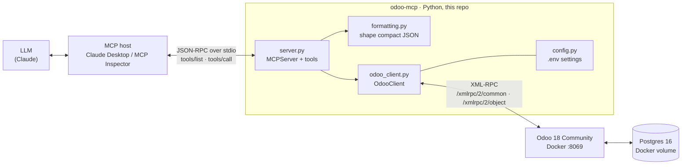

# Odoo MCP Server

[](https://github.com/rizkyagung18/odoo-mcp-server/actions/workflows/ci.yml)
[](LICENSE)

An [MCP](https://modelcontextprotocol.io) server that lets an LLM (Claude Desktop, or any MCP host) read and carefully write **Odoo 18** data: CRM leads, customers, sales orders and invoices.

This is a learning/portfolio project. It runs against a local Odoo with **demo data only**, the code is kept small, and comments explain the MCP concepts where they first appear.

| Tool | What it does | Writes? |
|---|---|---|
| `list_leads(stage?, limit=10)` | CRM leads and opportunities, biggest expected revenue first | no |
| `search_partners(query, limit=10)` | Customers/contacts by name, email or phone | no |
| `get_sales_orders(state?, limit=10)` | Quotations and sales orders (`draft`, `sent`, `sale`, `cancel`) | no |
| `get_unpaid_invoices(limit=10)` | Posted customer invoices not fully paid, with days overdue | no |
| `pipeline_summary()` | Opportunity count, expected and weighted revenue per stage | no |
| `create_lead(name, partner_name?, email?, expected_revenue?, confirm=false)` | Preview, then create a CRM lead | **yes**, disabled by `ODOO_READ_ONLY=true` |

Every tool returns compact JSON. Relations are resolved to names, Odoo's `False` becomes `null`, and results are capped at 50 records.

## Architecture



How one question flows through the system:

1. The host starts `odoo-mcp` as a subprocess and asks for `tools/list`. It gets each tool's name, description (the docstring) and input JSON schema (from the type hints).
2. You ask "who owes us money?". The LLM picks `get_unpaid_invoices` and the host sends `tools/call`.
3. `server.py` calls `OdooClient`, which logs in once over XML-RPC and runs `search_read` on `account.move`.
4. `formatting.py` trims each record to a few fields. The host passes the JSON back to the LLM, which writes the answer.

```
src/odoo_mcp/
  server.py        MCP server and tools (start here)
  odoo_client.py   XML-RPC wrapper with clear error types
  formatting.py    pure functions: raw Odoo record -> compact dict
  config.py        loads .env (by absolute path)
scripts/           init_db.sh, check_odoo.py, show_leads.py
tests/             unit tests (mocked) + optional integration tests
```

## Setup

Prerequisites: Docker Desktop, [uv](https://docs.astral.sh/uv/), and Node.js 22+ (only for the MCP Inspector).

```bash
# 1. Start Odoo 18 + Postgres 16
docker compose up -d

# 2. Create the "odoo_demo" database with demo data + CRM, Sales, Invoicing (~1 min)
./scripts/init_db.sh

# 3. Check it (login admin/admin, modules installed, demo records present)
python3 scripts/check_odoo.py

# 4. Python environment + settings
cp .env.example .env        # defaults match the local Docker setup
uv sync

# 5. Prove the API connection
uv run python scripts/show_leads.py
```

Odoo itself is at <http://localhost:8069> (log in as `admin` / `admin`).

| Variable | Default | Meaning |
|---|---|---|
| `ODOO_URL` | `http://localhost:8069` | Odoo base URL |
| `ODOO_DB` | `odoo_demo` | Database name |
| `ODOO_USER` | `admin` | Login |
| `ODOO_PASSWORD` | `admin` | Password or (better) an Odoo API key |
| `ODOO_READ_ONLY` | `false` | `true` removes all write tools |

## Try it with the MCP Inspector

The Inspector is a small UI that acts as an MCP host, so you can call the tools by hand.

```bash
npx @modelcontextprotocol/inspector uv --directory /path/to/odoo-mcp-server run odoo-mcp
```

Open the printed `http://127.0.0.1:6274?MCP_INSPECTOR_API_TOKEN=…` URL and switch the **uv** server on. Then go to **Tools**, pick a tool, and click **Execute Tool**.

The same thing from the terminal (handy for scripts):

```bash
DIR=/path/to/odoo-mcp-server
npx @modelcontextprotocol/inspector --cli --method tools/list uv --directory $DIR run odoo-mcp
npx @modelcontextprotocol/inspector --cli --method tools/call --tool-name pipeline_summary uv --directory $DIR run odoo-mcp
npx @modelcontextprotocol/inspector --cli --method tools/call --tool-name list_leads \
  --tool-arg stage=Proposition --tool-arg limit=3 uv --directory $DIR run odoo-mcp
# read-only mode: create_lead disappears from the list
npx @modelcontextprotocol/inspector --cli -e ODOO_READ_ONLY=true --method tools/list uv --directory $DIR run odoo-mcp
```

Inspector 2.16 asks for Node `^22.23.4 || ^24.22.1 || >=26.12.1`. On an older patch release, npm prints an `EBADENGINE` warning, but the Inspector still works.

## Connect to Claude Desktop

1. Open Claude Desktop → **Settings → Developer → Edit Config**. That opens `~/Library/Application Support/Claude/claude_desktop_config.json`.
2. Add the server. Use **absolute paths**: GUI apps don't see your shell's `PATH`, so `"command": "uv"` alone usually fails. Find yours with `which uv` and `pwd`.

   ```json
   {
     "mcpServers": {
       "odoo": {
         "command": "/absolute/path/to/uv",
         "args": [
           "--directory",
           "/absolute/path/to/odoo-mcp-server",
           "run",
           "odoo-mcp"
         ]
       }
     }
   }
   ```

   Credentials come from the project's `.env`. You can override any variable per host with an `"env"` block, for example `"env": { "ODOO_READ_ONLY": "true" }` for a safe, read-only connection.
3. Quit Claude Desktop completely (⌘Q) and reopen it. "odoo" should appear under the tools/connectors menu.
4. If it doesn't show up, check the logs in `~/Library/Logs/Claude/` (look for the `mcp*` files).

## Example prompts

- "Summarize my sales pipeline by stage. How much revenue is weighted by probability?"
- "Show the three biggest opportunities in the Proposition stage and who owns them."
- "Which customers have unpaid invoices, and how many days overdue are they?"
- "Find the contact details for Wood Corner."
- "List the five most recent confirmed sales orders."
- "Create a lead 'Standing desks for Ready Mat', expected revenue 8,000, email buyer@readymat.example." Claude shows a preview first; reply "yes, create it" to confirm.

## How writes are kept safe

- **Preview, then confirm.** `create_lead` writes nothing unless `confirm=true`. The first call returns exactly what would be created, so the user can approve it. This step relies on the LLM following instructions, so it's a convenience, not a guarantee.
- **Tool annotations.** Read tools carry `read_only_hint=true`. `create_lead` carries `read_only_hint=false`, so hosts like Claude Desktop ask you before running it.
- **`ODOO_READ_ONLY=true`** is the hard switch. Write tools are not registered at all, so the LLM never sees them. As a second line of defence, `OdooClient.create()` refuses to run.
- **Bounded inputs and outputs.** Inputs are checked against the schema (`limit` 1–50, an enum for order state) before any Odoo call, and outputs are trimmed to a few fields per record.
- **Readable errors.** Odoo failures become `ToolError`, the only error type whose message the LLM can read. For example: "Cannot reach Odoo… Is Odoo running?" or "Login failed…". Text from any other exception is hidden from the model by the SDK.

## Tests

```bash
uv run pytest                     # everything (integration tests skip if Odoo is down)
uv run pytest -m "not integration"  # unit tests only, no Odoo needed
uv run pytest -m integration -v     # only the live tests against local Odoo
```

- `tests/test_odoo_client.py` mocks `xmlrpc.client.ServerProxy`. It covers login caching, bad credentials, unknown databases, network errors, trimming of Odoo tracebacks, `execute_kw` arguments and the read-only guard.
- `tests/test_formatting.py` checks how raw records are trimmed into compact JSON.
- `tests/test_tools.py` injects a fake client. It calls the tools directly, and also goes through the real MCP protocol using the SDK's in-memory `Client`. That covers schemas, `is_error` results, hidden exception text and read-only tool registration.
- `tests/test_integration.py` makes read-only calls against the running demo database.

## MCP concepts in this repo

| Concept | Where |
|---|---|
| Server object, `instructions` | `server.py`: `MCPServer("odoo", instructions=...)` |
| Tool = function + docstring + type hints | `@mcp.tool()` on each read tool |
| Per-parameter schema (descriptions, limits, enums) | `Annotated[..., Field(...)]`, `Literal[...]` |
| Tool annotations | `READ_ONLY` / `WRITE` (`ToolAnnotations`) |
| Errors the model can read | `odoo_errors()` → `ToolError` |
| stdio transport (never `print()` to stdout) | `main()` → `mcp.run()` |
| Conditional tools | `create_lead` registered only when not read-only |

The code targets the **MCP Python SDK v2** (`mcp>=2.3`). In v2, `FastMCP` was renamed to `MCPServer` (`from mcp.server import MCPServer`), and `ToolError` lives in `mcp.server.mcpserver.exceptions`. Many tutorials still show the v1 `from mcp.server.fastmcp import FastMCP` import, which no longer exists.

## Next steps

- **React Native mobile client.** A phone can't spawn a stdio subprocess. Run the server over the Streamable HTTP transport (`mcp.run(transport="streamable-http")`) behind HTTPS. Then build an RN app that sends the user's message plus the tool list to an LLM API and forwards tool calls to this server. Authentication becomes mandatory at that point (see below).
- **More Odoo models.** Products and stock levels, CRM activities and follow-ups, purchase orders, HR. Add MCP *resources* (e.g. `odoo://lead/{id}`) and *prompts* (e.g. a "weekly sales review" template), plus a few more safe write tools (log a note, schedule an activity) using the same preview/confirm pattern.
- **Auth hardening.**
  - Use an Odoo **API key** instead of the admin password.
  - Connect as a dedicated low-privilege Odoo user (e.g. Sales: own documents only), so Odoo's access rules limit what the LLM can see.
  - Keep secrets in the macOS Keychain or a secrets manager instead of `.env`.
  - For HTTP deployments, add OAuth (the SDK supports `auth=` / `token_verifier=`), rate limiting and audit logging of every write.
  - Stop passing raw Odoo error text (which can include internal hostnames) back to the model.
- **Odoo 19+ API.** Odoo 19 introduced the JSON-2 API (`POST /json/2/<model>/<method>` with an API key as a bearer token). XML-RPC/JSON-RPC are deprecated and scheduled for removal in Odoo 22. Because every call goes through `OdooClient.execute_kw`, switching is a change to one class.

## License

[MIT](LICENSE)
